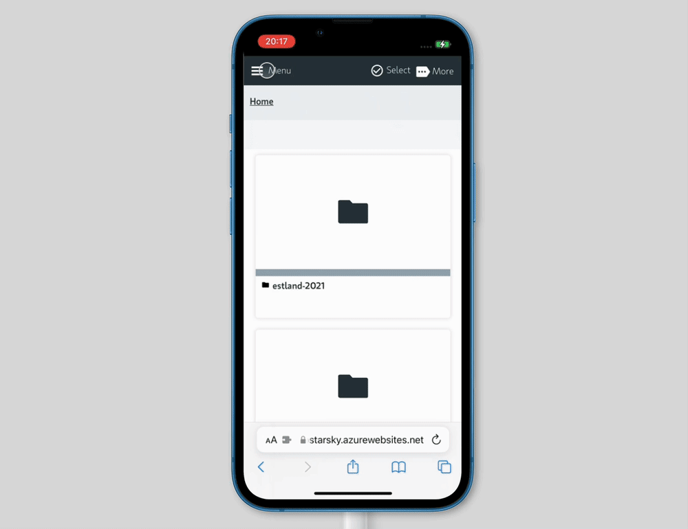

# Search

The app lets you search and find based on meta data, with easy to use filters and fast results. 
No need to waste time trying to remember what you photographed last year.

Search and find photos based on keywords through the whole photo library.

_Screenshot from: https://demo.qdraw.nl and `search?t=wolken` page_

## Search syntax

Words without a prefix search in the tags. Use `-Field` prefixes to search other fields, for example
`-Description:holiday` or `-FileName:IMG_`. The query is sent to `/api/search?t=<query>&p=<page>&collections=<bool>`.

| Syntax | Meaning |
|---|---|
| `-Tags:sunset` | Field contains the value (`:` and `=` are the same, `;` also works) |
| `-DateTime>2024` or `-DateTime<2024` | Greater than / less than, for example for dates and ratings |
| `-Tags-sunset` | Field does not contain the value (`-` after the field name) |
| `-Tags:a,b` | Any of the comma separated values (OR) |
| `A && B` / `A \|\| B` | Combine terms with AND / OR |
| `"quoted text"` | Search for a phrase that contains spaces |
| `-inurl:folder` | Shortcut for `-FilePath` (search in the path) |

Field names are the properties of a file, such as `Tags`, `Description`, `Title`, `FileName`,
`FilePath`, `DateTime`, `ColorClass` and `Software`.
Related endpoints: `/api/suggest` (suggestions while typing) and `/api/search/relative-objects`
(previous and next item within the search result).

## A Painless Search Pane

Make the challenge of hunting for files a thing of the past with the new Advanced Search feature.
Choose from numerous search criteria, including XMP Metadata
and EXIF & IPTC fields. Built-in logic for AND/OR states
let you narrow down results to a microscopic level.

## Unrivalled Digital Asset Management

Searching for files in the app is like a dream. 
Finding, sorting, moving, organizing, and sharing—everything 
you need for complete mastery over your photography workflow is right here, 
at your fingertips. No uploading or importing of images needed. 

Add ratings, tags, location data and (customizable) color labels 
to your files for easy sorting. 
Keep a closer eye on your data with the Info Palette.

