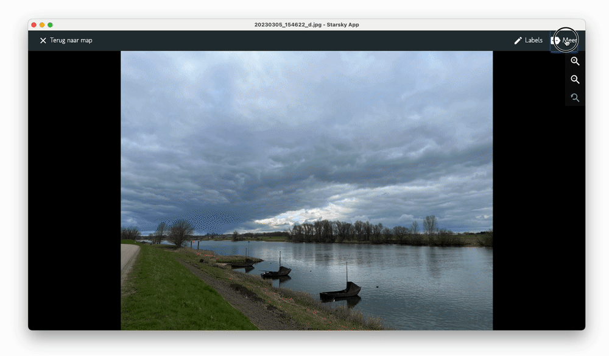

# Trash

When you delete a file in Starsky, it is not permanently removed. Instead, the app moves the file to the system trash (on macOS) or the recycle bin (on Windows). This approach ensures that files can be easily restored using the built-in recovery features of your operating system, providing an extra layer of safety for accidental deletions.

On platforms other than macOS or Windows, or when `useSystemTrash` is disabled, Starsky uses its own internal trash. In this case, deleted files are tagged with `!delete!` and are only recoverable from within the app, not through your operating system.

_Screenshot from: internal database_

## Settings

- `useSystemTrash` (`app__UseSystemTrash`): force the system trash on (`true`) or off (`false`). By default
  (not set) the app detects whether the system trash is supported on the platform.

## How it works

1. **Move to trash**: the app moves the selected file(s) to the system trash, or, with the internal trash, adds
   the `!delete!` tag to the file. With the internal trash the file stays on disk and in the database.
2. **Trash view**: files with the `!delete!` tag are listed in the trash view (`/api/search/trash`).
3. **Permanent delete**: from the trash view you can remove the files from the disk. The server only
   removes files that contain the `!delete!` tag, other files are rejected.

Removing the `!delete!` tag from a file in the internal trash brings it back in the normal views.
When collections are used, files with the same name before the extension (for example a `.jpg` and a raw)
are moved or deleted together.

## API

| Endpoint | Method | Description |
|---|---|---|
| `/api/trash/move-to-trash` | POST | Move files to the trash (`f`: sub paths separated by `;`, `collections`) |
| `/api/trash/detect-to-use-system-trash` | GET | Returns if the system trash is used |
| `/api/search/trash` | GET | List the files in the internal trash |
| `/api/delete` | DELETE | Permanently remove files that have the `!delete!` tag (`f`, `collections`) |

See the [API reference](../developer-guide/api/readme.md) for all endpoints.
