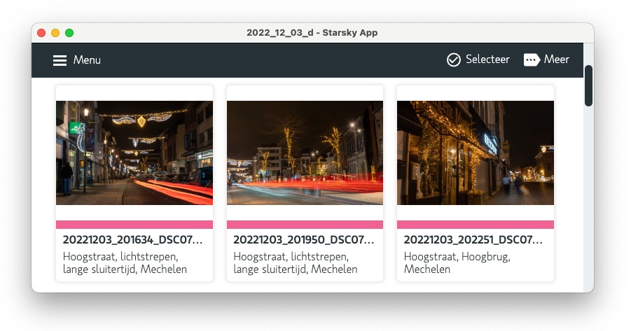

import Button from "@site/src/components/button";

# Getting Started

Starsky is a self-hosted photo manager. Your photos stay as normal files in normal folders;
Starsky indexes them, reads and writes their EXIF/XMP metadata, and gives you a web interface
(and desktop apps) to browse, search, tag and publish them.



## Pick your path

| I want to... | Do this |
|---|---|
| Look around first | [Try the online demo](https://demo.qdraw.nl). No login needed |
| Use it on my own computer | [Install the desktop app](desktop/readme.md) (macOS or Windows) |
| Run it on a server or NAS | [Run it with Docker](#quick-start-docker), or see [all server options](setup.md) |
| Run it on a Raspberry Pi | [Raspberry Pi guide](raspberry-pi.md) |

## Quick start (Docker)

This starts Starsky with SQLite and serves `~/Pictures` on port 6470:

```bash
docker run -d \
  --name starsky \
  --security-opt seccomp=unconfined \
  --security-opt apparmor=unconfined \
  -p 6470:6470 \
  -e PORT=6470 \
  -e app__databaseType="sqlite" \
  -e app__storageFolder="/app/pictures" \
  -e app__useDiskWatcher="false" \
  -e DOTNET_USE_POLLING_FILE_WATCHER="true" \
  -v /app/storage \
  -v ~/Pictures:/app/pictures \
  qdraw/starsky
```

Open [http://localhost:6470](http://localhost:6470), then follow [First steps](first-steps.md) to index your library.
For MySQL/MariaDB, Docker Compose and Kubernetes, see the [Docker guide](docker/docker.md).

## What you get

- Browse photos and videos, including RAW+JPEG pairs and stacks
- Find pictures with search filters on tags, description, date and camera data
- Metadata is read from and written back to the file (EXIF, XMP), so you can switch tools at any time
- One-click import from an SD card or folder
- A Progressive Web App interface that you can install on a phone's home screen
- Optional [MCP server](../features/mcp.md) for AI agents

See the [full feature list](../features/readme.md).

## Privacy

Starsky is an independent, self-funded project with no accounts to create on a third-party
service. Nothing is sent to Google, Amazon, Microsoft or Apple unless you choose to upload
files to one of their services. Anonymous usage telemetry exists and can be switched off, see
[what is collected](../advanced-options/starsky/telemetry.md).

<Button href="https://demo.qdraw.nl" color="#25c2a0">
    Try the demo
</Button>
