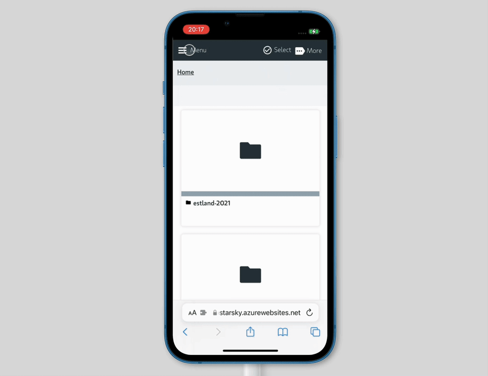

# Starsky

**A self-hosted photo manager that organises, searches and publishes your photo library using the metadata already inside your files.**

[](LICENSE)
[](https://github.com/qdraw/starsky/releases/)
[](https://github.com/qdraw/starsky/actions/workflows/webapp-build-net-ubuntu.yml)
[](https://sonarcloud.io/summary/new_code?id=starsky)
[](https://hub.docker.com/r/qdraw/starsky)

[**Live demo**](https://demo.qdraw.nl) · [**Download desktop app**](https://docs.qdraw.nl/download/) · [**Documentation**](https://docs.qdraw.nl/) · [**Changelog**](history.md)



Your photos stay as normal files in normal folders. Starsky indexes them, reads and writes
their EXIF/XMP metadata, and gives you a fast web interface to browse, search, tag, rename,
geotag and publish them. There is no proprietary library format to get locked into.

The demo needs no login. It runs on a free tier and sleeps after 30 minutes of inactivity, so
give it a moment to warm up. Changes made in the demo are not saved.

## Features

- **Import** from SD cards or folders, sorted into a folder structure based on the capture date
  (configurable)
- **Search** by tag, description, date, location and more
- **Bulk editing** of tags, titles and descriptions across many photos at once
- **Rename** single files or whole sets by capture date, and shift timezones
- **Geotagging**: match a GPX track to your photos, and reverse-geocode locations
- **Stacks, trash and video** support
- **Thumbnails** generated in the background, or taken from the embedded preview for speed
- **Publish** a selection as a static web page, optionally pushed over FTP
- **Export** and **realtime** updates in the UI when files change on disk
- **MCP server** (opt-in) so AI agents such as Claude can search and read your library. Writes
  require an explicit confirmation step
- **Multi-user** with account management, usable from CLI tools as well as the UI

## Quick start

With Docker and SQLite:

```bash
docker run -d \
  --name starsky \
  --security-opt seccomp=unconfined \
  --security-opt apparmor=unconfined \
  -p 6470:6470 \
  -e PORT=6470 \
  -e app__databaseType="sqlite" \
  -e app__storageFolder="/app/pictures" \
  -e app__useDiskWatcher="false" \
  -e DOTNET_USE_POLLING_FILE_WATCHER="true" \
  -v /app/storage \
  -v ~/Pictures:/app/pictures \
  qdraw/starsky
```

Then open <http://localhost:6470>. MySQL/MariaDB, Windows, Raspberry Pi, systemd and other
setups are covered in the [getting started guide](documentation/docs/getting-started/readme.mdx).

Prefer a desktop app? There are native builds for [macOS and Windows](readme-desktop.md).

## Tech stack

| Layer | Technology |
|---|---|
| Backend | .NET 10, ASP.NET Core, Entity Framework (SQLite or MySQL/MariaDB) |
| Web UI | React, TypeScript, Vite |
| macOS app | Swift / AppKit, WKWebView shell, Sparkle auto-updates |
| Windows app | WPF |
| CLI tools | Nine .NET command line tools (import, sync, geo, thumbnails, publish, admin, ...) |
| Testing | MSTest (5,000+ test methods), Jest + Testing Library, Cypress end-to-end |
| Delivery | Docker, GitHub Actions, Azure Pipelines, SonarCloud, Codecov |

## Architecture

All business logic lives in the backend. The React app, the desktop apps, the CLI tools and the
MCP server are thin layers that call the same services, so a rule such as "how a file is
renamed" exists in exactly one place.

The solution is split into `starsky.feature.*` (one library per capability, such as search,
import or trash) and `starsky.foundation.*` (shared infrastructure such as storage, database
and metadata reading). Tests mirror that structure, and use hand-written fakes instead of a
mocking framework. See [CLAUDE.md](CLAUDE.md) and the
[developer guide](documentation/docs/developer-guide/readme.md) for the conventions.

## Project layout

| Path | What it is |
|---|---|
| [`starsky/`](starsky/readme.md) | .NET solution: web API, CLI tools, libraries and tests |
| [`starsky/starsky/clientapp/`](starsky/starsky/clientapp/readme.md) | React front-end |
| [`starsky-tools/`](starsky-tools/readme.md) | Node.js helper scripts and the Cypress end-to-end suite |
| [`mac/`](mac/readme.md) | Native macOS app |
| [`windows/`](windows/readme.md) | Windows desktop app |
| [`documentation/`](documentation/README.md) | Docusaurus documentation site |

Each CLI tool has its own readme, linked from the [solution readme](starsky/readme.md).

## Build from source

```bash
git clone https://github.com/qdraw/starsky.git
cd starsky
./build.sh        # macOS / Linux, builds everything and runs the tests
```

On Windows use `.\build.ps1`. Details and prerequisites are in the
[solution readme](starsky/readme.md).

## Contributing

Bug reports and pull requests are welcome, see [CONTRIBUTING.md](CONTRIBUTING.md). For
questions and ideas, please use [GitHub Discussions](https://github.com/qdraw/starsky/discussions).
Security issues: see [SECURITY.md](SECURITY.md).

## About

Starsky is built and maintained by Dion ([@qdraw](https://github.com/qdraw)),
[qdraw.nl](https://qdraw.nl/contact.html). It started as a personal tool for a growing photo
archive: fast search, no lock-in, import from an SD card, and geotagging from a GPX track
recorded on a phone. It grew into a multi-platform application.

Licensed under the [MIT License](LICENSE).

<details>
<summary>Build and quality status</summary>

| | |
|---|---|
| .NET | [](https://github.com/qdraw/starsky/actions/workflows/webapp-build-net-windows.yml) [](https://github.com/qdraw/starsky/actions/workflows/webapp-build-net-ubuntu.yml) [](https://qdraw.visualstudio.com/starsky/_build/latest?definitionId=17&branchName=master) |
| React | [](https://github.com/qdraw/starsky/actions/workflows/clientapp-react-linux-ci.yml) |
| End-to-end | [](https://github.com/qdraw/starsky/actions/workflows/end2end-ubuntu-ci.yml) |
| Docker | [](https://github.com/qdraw/starsky/actions/workflows/webapp-unstable-docker-buildx.yml) |
| Desktop | [](https://github.com/qdraw/starsky/actions/workflows/desktop-macos-sonarqube.yml) [](https://github.com/qdraw/starsky/actions/workflows/desktop-windows-sonarqube-net.yml) [](https://github.com/qdraw/starsky/actions/workflows/desktop-release-on-tag-native.yml) |
| Coverage | [](https://codecov.io/gh/qdraw/starsky) |
| SonarCloud | [](https://sonarcloud.io/dashboard?id=starsky) [](https://sonarcloud.io/summary/new_code?id=starsky) [](https://sonarcloud.io/dashboard?id=starsky) [](https://sonarcloud.io/dashboard?id=starsky) [](https://sonarcloud.io/summary/new_code?id=starsky) |

See [the documentation](https://docs.qdraw.nl/docs/developer-guide/github-actions/) and
`./pipelines/azure` for pipeline details.

</details>

## List of __[Starsky](readme.md)__ Projects

* [By App documentation](starsky/readme.md) _database photo index & import index project_
    * [starsky](starsky/starsky/readme.md) _web api application / interface_
        * [clientapp](starsky/starsky/clientapp/readme.md) _react front-end application_
    * [starskyImporterCli](starsky/starskyimportercli/readme.md)  _import command line interface_
    * [starskyGeoCli](starsky/starskygeocli/readme.md)  _gpx sync and reverse 'geo tagging'_
    * [starskyWebHtmlCli](starsky/starskywebhtmlcli/readme.md)  _publish web images to a content
      package_
    * [starskyWebFtpCli](starsky/starskywebftpcli/readme.md)  _copy a content package to a ftp
      service_
    * [starskyAdminCli](starsky/starskyadmincli/readme.md)  _manage user accounts_
    * [starskySynchronizeCli](starsky/starskysynchronizecli/readme.md)  _check if disk changes are
      updated in the database_
    * [starskyThumbnailCli](starsky/starskythumbnailcli/readme.md)  _speed web performance by
      generating smaller images_
    * [starskyThumbnailMetaCli](starsky/starskythumbnailmetacli/readme.md)  _create small thumbnails from the embedded preview_
    * [Starsky Business Logic](starsky/starskybusinesslogic/readme.md) _business logic libraries (
      .NET)_
    * [starskyTest](starsky/starskytest/readme.md)  _mstest unit tests (for .NET)_
* [starsky-tools](starsky-tools/readme.md) _nodejs tools to add-on tasks_
* [Starsky Desktop](readme-desktop.md) _Desktop Application_
    * [Download Desktop App](https://docs.qdraw.nl/download/) _Windows and macOS version_
* [Changelog](history.md) _Release notes and history_
